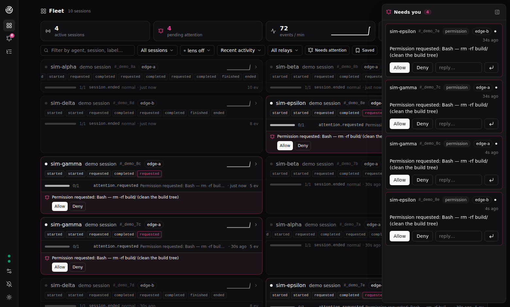

# Mission Control

**A real-time fleet UI for [Agent Event Protocol](https://github.com/agenteventprotocol/agent-event-protocol)
sessions: live lanes, an attention inbox with tap-to-respond, causal graphs.**

AEP is an open standard for the events AI agents emit while they work.
Mission Control is its first-party *consumer*: a browser app that watches many
agent sessions at once and lets you intervene when an agent asks. It talks
to agents exclusively through the protocol — events in over the relay's SSE
stream, commands out over the control socket — which makes it a living proof
of AEP's core claim: **any consumer, including a browser tab, can join the
fleet stream with the SDK and drive the control round-trip.** No side
channels, no privileged endpoints, no server tier of its own.

[](https://github.com/agenteventprotocol/mission-control/actions/workflows/ci.yml)
[](LICENSE)



## What you get

- **Attention, everywhere** — when an agent asks, you can't miss it and you
  don't have to go looking: a dock slides in on whatever screen you're on
  (answer right there — options, free text, full AEP-0006 forms), the
  session's fleet card grows an inline quick-answer strip, the nav badge
  and the browser-tab title count what's waiting. Requests settle only when
  the answer is confirmed *on the stream*, so a request answered anywhere
  converges everywhere — and the attention center keeps the decision
  history: what was asked, how it settled, with what answer.
- **Fleet at a glance** — vitals up top (active sessions, pending
  attention, events/min with a 20-minute sparkline, recent warnings), then
  one card per session that narrates itself: live status pulse, the
  session's own activity sparkline, a monochrome chip timeline with a
  shared hover card for details, a run ribbon (failures and cancellations
  jump out), and the latest event live. The UI stays black-and-white;
  color marks only what matters — attention, severity heat, connection
  health.
  Filter by text, status, or the severity lens; sort by activity,
  needs-you-first, or agent.
- **Replay any window** — session detail has a dual-ended replay range:
  drag *both* ends to isolate any slice of history across the virtualized
  timeline and the **causal canvas** — an interactive zoom/pan graph of
  card nodes in causal layers, solid curved `cause` edges, dashed
  id-resolving `subject` edges — then snap back to live. The capture-aware
  inspector highlights `*_digest` fields and `[REDACTED …]` stand-ins.
- **Live tail** — every event this observer receives, in arrival order,
  filterable, one click from its session.
- **Honest resume** — positions are persisted per relay; a cold start
  replays every known session gap-free, and a relay-side history gap is
  *shown*, never guessed around.
- **Several relays, one window** — add relays in the settings dialog and
  watch them all: every lane belongs to exactly one relay (chips name it,
  the rail shows a dot per relay, the fleet filter can isolate one), and
  answers always route back over the relay that owns the session.
- **Cancel a stuck run** — active runs carry a cancel affordance (the
  session header, and the fleet card's run row on hover) that sends
  `control.cancel` over the owning relay after a confirm. The agent stays
  sovereign — it may refuse — and the ribbon flips to *cancelled* only
  when the cause-linked `run.cancelled` arrives on the stream; a nack or
  ack-window silence reverts with the reason shown. Imported captures and
  disconnected relays say honestly why cancel isn't available.
- **Steps and state, first-class** — agents that emit the optional
  `run.step.*` and `state.*` families (the AG-UI bridge, for one) get
  structure: timeline rows group under their step, the causal graph marks
  step boundaries, and a State tab reconstructs the session state from
  snapshots plus ordered patches — capture-honestly (patch bodies withheld
  by the ceiling are counted, never fabricated).

## Try it in one command

Prerequisites: Node ≥ 22 and [pnpm](https://pnpm.io) (`corepack enable`).

```sh
git clone https://github.com/agenteventprotocol/mission-control.git
cd mission-control
./run-demo.sh
```

That boots a relay (the vendored reference-relay fixture) with a generated
session token — printed in the banner, because control flows only on
authenticated bindings (AEP-0004 §4.1) — serves the production build at
`http://127.0.0.1:8788`, and keeps a small synthetic fleet emitting — a
fresh batch of three sessions every ~30 s, each raising one attention
request. Open the app, go to Connections (the rail's cable icon or the gear) →
Manage relays, paste the banner's token, and Apply; watch the lanes fill,
answer the pending request from the inbox, and watch
the control round-trip land on the stream. Ctrl-C tears everything down. `./run-demo.sh --once` runs the
same boot self-asserting (relay discovery up, one synthetic session
completes, app serves) and exits 0/1 — useful for scripted verification.
Ports: `AEP_PORT` (relay, default 8787 — the app's built-in default) and
`AEP_MC_PORT` (app, default 8788). `./run-demo.sh --two-relays` boots a
second relay (`AEP_PORT2`, default 8790) with its own fleet. Add its URL
under Manage relays on the Connections page to watch the multi-relay
topology: lanes carry a
relay chip, the rail shows one dot per relay, and answers route to the relay
that owns the session.

## Run it against your own stack

```sh
pnpm install
pnpm dev             # builds the vendored SDK, serves http://127.0.0.1:8788
```

Point it at a relay (default `http://127.0.0.1:8787`) via the settings
button in the header. For a full synthetic demo, run the reference stack
next to it:

```sh
git clone https://github.com/agenteventprotocol/reference.git
cd reference && (cd impl/relay && npm ci)

# terminal 1 — the reference relay
node impl/relay/server.js

# terminal 2 — a small fleet, one agent asking for permission
node impl/demo/synthetic-agent.js --agent claude-sim --tools 3
node impl/demo/synthetic-agent.js --agent codex-sim --mode http
node impl/demo/synthetic-agent.js --agent gate-sim --attention
```

Watch the lanes fill, answer the permission request from the inbox, and
watch the run finish. Close the tab and reopen it: the lanes rebuild from
the persisted `(session, epoch, seq)` positions with no gaps.

To observe a **real** agent instead of the synthetic fleet, follow a
guided session: [docs/testing/](docs/testing/README.md) has one script
per capture surface — Claude Code first, then the other adapters and the
protocol bridges — each driving the same five-beat arc (lifecycle, tools,
attention, cancel, replay/resume) with honest per-surface expectations.

## Verify

```sh
pnpm run check       # = bash ci.sh
```

One command runs what CI runs: typecheck (the vendored SDK against its own
strict config, then the app), lint, unit + component tests — including the
**consumer-class self-certification**: the standard's golden conformance
corpus (vendored from the spec repo) driven through the real store, per the
class table's own instruction to consumers (dedupe on `id`,
unknown-type/attribute tolerance, AEP-0001 §7/§10) — the headless
end-to-end acceptance — live fleet over SSE, kill-and-reattach with no
gaps (the class row's `(session, epoch, seq)` resume obligation), attention
answer completing the control round-trip against the vendored
reference-relay fixture, plus the multi-relay beats (two relays, separate
lanes for a shared session name, answers routed to the owning relay, a dead
relay flipping only its own status) — and the production build. Everything
is offline after `pnpm install`.

## Layout

| Path | What it is |
|---|---|
| `app/src/core/` | The event-sourced store + relay connection — DOM-free, the part the headless tests exercise |
| `app/src/views/` | Fleet, inbox, session detail (timeline / causal graph / inspector), live tail |
| `app/src/components/` | UI primitives and event widgets (chips, severity dots, JSON tree) |
| `app/test/` | Unit, component, and end-to-end tests + vendored reference-stack fixtures |
| `vendor/aep-sdk/` | Pinned snapshot of [`typescript-sdk`](https://github.com/agenteventprotocol/typescript-sdk) (see `SDK_VERSION` and `vendor/aep-sdk/VENDORED.md`) |
| `ARCHITECTURE.md` | Topology, state model, resume strategy, control path |
| `docs/` | User guide, a tour of the views, and [guided live-session scripts](docs/testing/README.md) per capture surface |

## The ecosystem

- [`agent-event-protocol`](https://github.com/agenteventprotocol/agent-event-protocol) — the standard: spec, schemas, conformance
- [`typescript-sdk`](https://github.com/agenteventprotocol/typescript-sdk) / [`python-sdk`](https://github.com/agenteventprotocol/python-sdk) — official SDKs
- [`reference`](https://github.com/agenteventprotocol/reference) — the runnable stack: relay, CLI, adapters, bridges, demo

## Versioning

Mission Control ships no registry artifacts. It releases as a tagged whole
on its own SemVer line, alongside protocol releases, per the organization's
[VERSIONING.md](https://github.com/agenteventprotocol/agent-event-protocol/blob/main/VERSIONING.md)
(§5, "repositories that are not packages"). The manifest carries the shared
pre-release version core (`0.1.0-dev`) for consistency only — nothing here
is published to a registry.

The vendored `@agenteventprotocol/sdk` snapshot under `vendor/aep-sdk/` (see
[Layout](#layout)) is pinned byte-for-byte to the TypeScript SDK commit
recorded in `SDK_VERSION`, with a CI job that re-clones the pin and fails on
drift. Once `@agenteventprotocol/sdk` is published, that vendored snapshot is replaced by
an ordinary registry dependency (see `vendor/aep-sdk/VENDORED.md`).

## License

[Apache-2.0](LICENSE).
