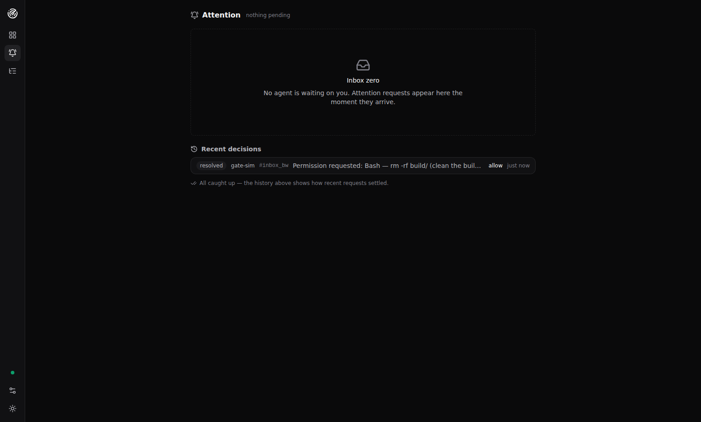
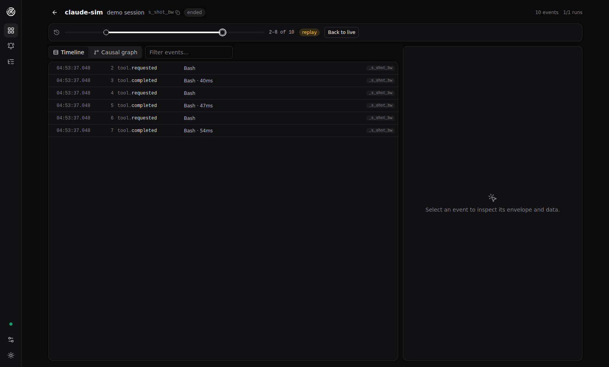
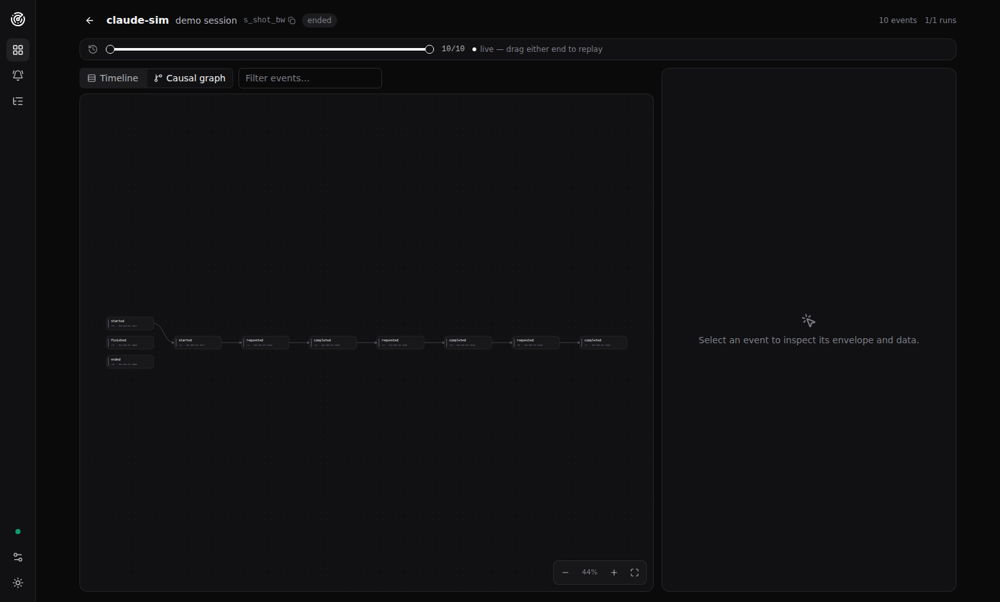

# The views

A tour of Mission Control's workspace. Each section names the source that
renders it, so behavior described here can be checked against the code.
Install/run steps: [user-guide.md](user-guide.md); design rationale:
[ARCHITECTURE.md](../ARCHITECTURE.md).

## The shell: rail + dock

Source: [`app/src/components/layout/`](../app/src/components/layout/).

Everything lives in one workspace: a slim **rail** on the left (Fleet,
Attention, Live tail; at the foot the connection dots (one per configured
relay), relay settings, and
the theme toggle) and the **attention dock** — a floating panel that
slides in from the right with pending requests, answerable inline, on
every screen. It is an overlay: it glides *over* the content and never
reflows the view underneath.

The dock is how attention stays impossible to miss: it **auto-opens the
moment a new request arrives**, wherever you are; the rail bell carries a
count; the browser-tab title gains a `(N)` prefix. Collapse the dock and a
floating "N need you" pill keeps the recall one click away. Cards honor
the request's own channel declaration (`respond_via` — AEP-0008): a
request answered in the agent's own UI renders as information — and a
FORM card (AEP-0006) in that posture still shows its **fields
read-only** (each question with its choices as chips, an `Other…`
marker where the vendor offers one, a `free-form answer` hint for text
fields), so you see exactly what the agent is asking its own user even
when the answer cannot travel from here. Views are
deep-linkable hash routes: `#/fleet`, `#/inbox`, `#/events`,
`#/sessions/<session id>`.

## Fleet (`#/fleet`)

Source: [`app/src/views/fleet/`](../app/src/views/fleet/).

The home view. A **vitals strip** first: active sessions, pending attention,
events/min with a 20-minute arrival sparkline, and warnings-and-above in the
last 15 minutes. Then one card per session:

- the header row shows a live status dot (breathing while active), agent,
  session label, short id, a `gap` badge when older history is no longer
  replayable, and the session's own 20-minute **activity pulse** sparkline
  — click the row to open session detail;
- below runs a horizontal chip timeline in store order — one monochrome
  chip per event, labeled with the last segment of its type (unknown types
  are kept, never dropped). Color appears only when it means something: a
  still-actionable `attention.requested` chip pulses pink, and events at
  `warning` severity or above carry heat. **Hovering any chip raises a
  shared hover card** (type, summary, time, severity, seq) — one floating
  layer for thousands of chips, no native tooltips;
- a narration footer reads the lane back to you: the **run ribbon** (one
  segment per run — finished in quiet ink, active shimmering; color marks
  only problems, failed red and cancelled amber), the run tally, a
  hover-revealed **cancel button** when a run is in flight (confirm
  dialog; the segment flips to cancelled only when the terminal arrives on
  the stream), and the **latest event** with its summary and age, live;
- **when the agent is waiting, the card itself asks**: an inline
  quick-answer strip with the request prompt and its option buttons (or a
  reply box; forms hand off to the dock's full renderer) — you unblock
  agents without leaving the fleet. A request that declares its response
  channel without `control` (`respond_via` — AEP-0008) renders as
  information instead: the agent answers in its own UI, and the strip
  says so rather than offering a doomed send.

The filter bar narrows by free text (agent, label, session id), status, and
pending-only; sets the **severity lens** (a floor that dims chips below it
and hides lanes that never reach it); and sorts by recent activity,
needs-you-first, or agent name. `#/fleet?q=<text>` deep-links into a
seeded free-text filter (the Connections topology's producer nodes land
here); the bar stays fully editable after the jump.

## Attention center (`#/inbox`)

Source: [`app/src/views/inbox/`](../app/src/views/inbox/).

The full-page view of the same items the dock shows (the dock hides here).
Every still-actionable request across all sessions, oldest first. Each card
shows the requesting agent, the session (click to jump), the request
`kind`, severity, a live age, the prompt — and the ways to answer:

- **Options** (`data.options`) render as buttons — one tap sends
  `control.attention.respond` with that option.
- **Forms** (`kind: "form"`, AEP-0006) render one control per field spec —
  text, number (honoring the spec's `min`/`max` bounds), checkbox, and
  single- or multi-select, either select kind with an optional "other…"
  free-text escape that wins over the picks — and one Submit that sends
  `answer.values` keyed by field id. Required fields are
  enforced by the *emitter*: an invalid submit is nacked, the error shows
  on the card, and your draft stays editable.
- **Free text** for anything else.

While a response is in flight the card shows *responding* and disables its
controls — but an item only settles when `attention.answered` /
`attention.resolved` arrive **on the stream**. That rule makes every
surface converge: a request answered from the dock, a fleet card, another
consumer or another tab disappears here too, and a nack or ack-window
timeout puts the card back to actionable with the error displayed.

Below the pending items, **Recent decisions** — the history the wire
already told us: each settled request with its outcome (`answered`/
`resolved`/`timed out`) and the answer that settled it.

## Session detail (`#/sessions/<id>`)

Source: [`app/src/views/session/`](../app/src/views/session/).

The header shows the agent, label, full session id (click to copy), status,
badges where they apply (`history gap`, `imported`, retention trims, the
owning relay past one configured), and a **Cancel run** button per active
run — confirm dialog, optional reason, disabled with the reason when the
lane has no live backchannel; the run settles only off the stream. A nack
renders `cancel failed: <reason>` right at the button — in the compact
fleet-lane rendering too, not just here (an outcome belongs at the click
site; a hover tooltip is not a troubleshooting surface). And once THIS
session has settled a control verb `refused · unsupported`, the
affordance says so up front — the cancel/steer/pause buttons carry an
observed-refusal advisory (visible text beside the session-header cancel,
the title elsewhere). Advisory only: observed capability can go stale, so
the send path is never removed — a target restarted with its gate opened
proves itself on the next send. Below
it, the **replay range**: a dual-ended slider — drag *either end* to window any
slice of how the session unfolded (both thumbs are keyboard-steppable).
While windowed, a `replay` chip shows and **Back to live** snaps to the
growing tail. Replay only caps what is displayed; nothing is re-derived.

- **Timeline** — the windowed events in store order, virtualized (tens of
  thousands of rows stay smooth): wall-clock time, `seq`, severity bar,
  type, a one-line summary, and the run tag. A text box
  filters rows; clicking a row selects it in the inspector. The list
  follows the tail only while live.
- **Causal graph** — the windowed events on an interactive canvas:
  wheel-zoom, drag-pan, and fit/zoom controls over a dot grid. Card nodes
  (type, `seq`, wall-clock time, an accent bar that carries heat above
  `warning` and pink on attention requests) are laid out in
  causal layers with a barycenter pass that keeps edges short; `cause`
  references draw solid curved edges, `subject` references that resolve to
  an event id draw dashed ones (a `subject` naming a resource, like a tool
  name, is not an edge). Hovering a node raises the same event hover card;
  clicking (or Enter on a focused node) selects it in the inspector, and
  edges touching the selection highlight.
- **State** — the session state reconstructed from `state.snapshot` +
  ordered `state.delta` patches, capture-honest: gated snapshots register
  without a value, gated patches show as op counts, and nothing is ever
  fabricated below the capture ceiling.
- **Control** — the control surface in two provenance-labeled halves.
  DECLARED (where the relay advertises the roster frame, AEP-0003
  §4.1): the live claim's own capability declarations, verbatim — the
  claiming agent's identity, its declared `accepts`, a snapshot
  timestamp; two connections claiming one session name render as
  visible ambiguity ("2 live connections claim this session name"),
  and a session the roster stopped listing says "no live claim" (a
  command would nack `no-route`). OBSERVED: each control verb this
  Mission Control has sent on the lane with its last settle
  (`accepted` / `refused · reason`, `untried` otherwise) plus the
  event kind families seen. Neither half gates sending — a declaration
  is a snapshot, never a promise (the target's accepts at command time
  stays authoritative), and a refusal is the designed answer, not a
  failure. On relays without the roster advertisement the declared
  block never appears and the panel is exactly what it was.
- **Inspector** — the selected event's full envelope and payload as a
  capture-aware JSON tree: the capture badge states the capture level,
  `*_digest` values carry a `digest` tag, `[REDACTED …]` stand-ins are
  highlighted, and one button copies the raw JSON.

## Live tail (`#/events`)

Source: [`app/src/views/events/`](../app/src/views/events/).

Every event this observer receives, across all sessions, in arrival order
(capped; the counter shows when older entries rotate out). Filter by free
text or the severity lens. Each row shows time, severity, session, agent,
type, and a summary; clicking a row jumps into that session's detail. The
tail follows new arrivals unless you scroll up.

## Connections (`#/connections`)

Source: [`app/src/views/connections/`](../app/src/views/connections/).

Operator visibility and control over the plumbing itself — everything
here is polled operational state, deliberately outside the
event-sourced store the other views fold from.

- **Overview** — one cross-relay picture in three labeled columns:
  **Agents → Relays → Mission Control**, with a plain-words legend.
  Each configured relay is a port-labeled hub; the MC↔relay edge is
  colored by the SAME per-relay stream state that drives the rail
  status dot (solid green = events flowing, dashed amber/red =
  connecting/stream error, dashed grey = not connected), and a failing
  edge's tooltip carries the failure detail plus a suggestion. Agent
  chips navigate to Fleet filtered to that agent (`#/fleet?q=<agent>`);
  relay chips scroll to their card; the relay the Local stack manages
  is tagged `local stack` — with several ports in play, which relay is
  which, and whether MC is actually listening to it, is answered in
  one glance. Bridges the Local stack is running appear as producer
  nodes of their own in the agents column (a small `bridge` tag; not
  clickable — the sessions a bridge emits carry the upstream agent's
  identity, so the honest navigation target is that agent's chip). The
  legend also states the system's hierarchy in one line: an agent
  *class* (catalog entry) runs as daemon *instances*; instances emit
  *sessions*; sessions carry *runs*. While the Local stack panel is connected, the **ops
  server is a node of its own** (port-labeled, under Mission Control):
  the MC↔ops edge is colored by the panel's own reachability, a dashed
  `manages` edge runs from the ops node to its relay, and agents the
  stack manages carry a dot marker — how the ops layer relates to
  everything else is ON the diagram, not implied by a text tag.
- **Relays** — one card per configured relay, fed browser-direct from
  the relay's own token-gated `GET /connections` introspection endpoint
  (an implementation surface of the reference relay, not part of the
  protocol): relay vitals (uptime, sessions, connections,
  subscriptions, whether control routing is on), a **Mission Control
  stream** row (the rail dot's own fact, rendered beside the
  introspection so the two sources can never silently contradict each
  other — and on `error`, the failure detail plus a plain-language
  suggestion, never a bare state; when the Local stack reports the
  relay up but the browser cannot reach its port — the forwarded-port
  case — the suggestion names that split and says to forward the relay
  port), and the connected-party roster:
  identity, role (consumers tagged), the control verbs each party
  declared at hello, and the sessions it owns. Session chips navigate
  into the session detail. A relay without the endpoint degrades to an
  honest "no introspection" note; the card managed by the ops API is
  badged "managed by local stack". **Manage relays** (top right) is
  the one place the relay set is edited by hand (URL, token, label,
  add/remove); the rail gear routes here too. Most users
  never open it: the local stack's relay configures itself.
- **Local stack** — process posture and actions over the reference
  setup tool's ops API (`node impl/setup/aep-setup.js serve`). `serve`
  prints a **connect link** (`#/connections?ops=…&opsToken=…`) — open
  it and the panel configures itself: the credentials ride the URL
  fragment (never sent over the network), Mission Control stores them
  and strips the secret from the address bar. Zero pasting; the printed
  URL + token still work in the header form as the manual path. The
  stack browses in three tabs — **Adapters | Bridges | Relay** — one
  card per *class*; a running class shows an **Instances** block: the
  managed daemon row (port, managed-here or not, relay-connected) and
  the sessions seen on the stream for that agent, deep-linking into
  Fleet. Per adapter: CLI detection, daemon health (up /
  relay-connected / port busy), registration state, and actions:
  - **Start** opens the **scenario dialog** — the whole flow in one
    click, rendered as a **live step list** (register when missing →
    start daemon → connect stream → open Fleet; each step shows
    pending / running / done / failed-with-reason, and a failure
    leaves the unreached steps visibly pending). Runtime options
    render from the setup tool's per-agent catalog (each option shows
    its env var and a hover "?" with help text; values ride
    `POST /api/up {env}` and are catalog-validated server-side) —
    **enum options render as dropdowns** (the capture ceilings, the
    otlp-in vendor profile), suggestion-bearing free text gets a
    datalist, and secret-marked values (the OpenHands session key) are
    masked. Every executed step still lands its **receipt** naming the
    CLI line it mirrors; vendor consent steps the tool cannot perform
    (Codex `/hooks` trust, Hermes first-use consent, VS Code Preview
    enable) surface as explicit manual beats.
  - **Bridges** — the five startable bridge daemons (`otlp-in`, the
    OpenCode and Kilo SSE receivers, the AG-UI tee, the OpenHands
    observer) get the same card, catalog-driven options (argv flags
    like `--vendor`/`--primary` included), Start/Stop/Restart/Logs,
    and remembered runtime options; their scenario is shorter (no
    registration step — bridges have none). `bridge-acp` renders as an
    honest information card: it is editor-launched by design (the
    stdio tee is the ACP editor's agent command) and offers no Start.
  - **Stop / Restart / Logs** for daemons the setup tool itself
    started — a daemon found healthy on its port without a pid file is
    labeled "not managed here" and left alone; while an action is in
    flight the card says so ("starting…", "stopping…") and the state
    refreshes the moment it returns. **Restart re-applies
    the runtime options this panel last started the process with** (a
    rebooted daemon keeps only its boot-time env, so a bare restart
    would silently drop, say, the steering toggle); the button's
    tooltip names the exact `down && up --env …` line it composes. A
    daemon last started from the CLI keeps only what your CLI gave
    it. The **Relay** tab offers **Start relay** when the relay is
    down — with the relay's own options disclosure (the five
    ingest/replay caps from its catalog; port, host, and token stay
    tool-managed), remembered and re-applied on Restart like any
    other process.
  - **Config** — the preview-first registration dialog (exactly what
    `write` would apply, timestamped backup, idempotent), with the
    project-scoped option and an optional **project directory** field
    (`--project-dir` on the CLI) for registering into a workspace
    without running the tool from it.
  - **The automatic stream bridge** — the ops API reports the relay's
    URL and token (the ops-token holder already controls that relay's
    lifecycle), and connecting the ops endpoint IS the consent to
    mirror its stack: Mission Control adopts the relay's stream token
    by itself, with a visible "adopted from the local stack" receipt —
    never a silent write, never a second decision. The row then shows
    MC's own stream state inline — the fact the rail status dot
    reports — with the failure detail and a visible suggestion when it
    errors; because this row only renders while the stack reports the
    relay up, a browser-side failure here reads as the two-vantage
    split and the suggestion says to forward the relay port.

  When the ops API is absent the section teaches the one command that
  starts it. **Every action names the CLI line it mirrors** — the panel
  is the smooth path, the programmatic path stays the learnable asset.
  The zero→watching sequence and the default port map are diagrammed in
  the reference setup README (`impl/setup/README.md`).
